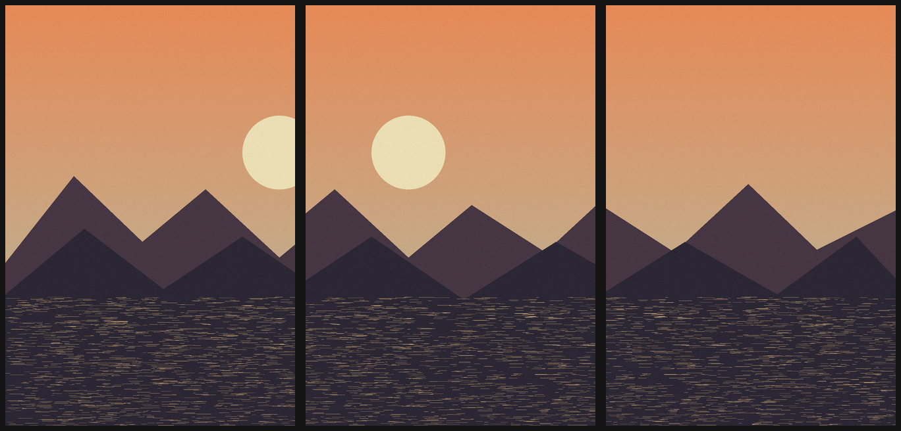
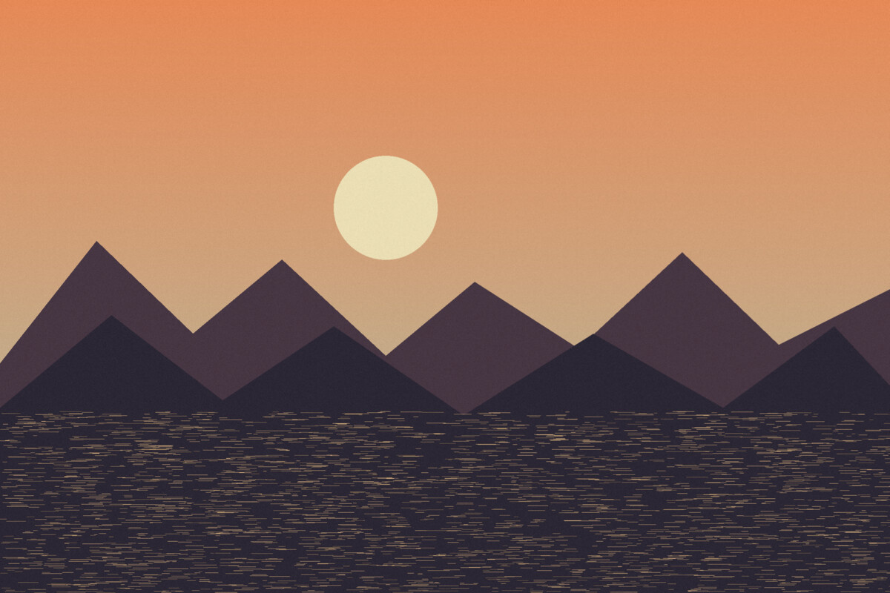

# Scan to image

Turn overlapping digital-camera scans of film negatives into one clean positive
image. Everything runs locally in a single native Rust binary: no cloud service,
no OpenCV, no Python and no web view.

## Example

Three overlapping scans of one negative:



Stitched by the app:



## Install and run

Rust 1.95 or newer is required. Linux needs the usual X11/Wayland development
packages and a working Vulkan or OpenGL driver. macOS uses Metal.

```sh
git clone <repository-url>
cd scan-to-img
cargo build --release
./target/release/scan-to-img
```

With [`just`](https://github.com/casey/just) installed:

```sh
just run
```

Pass image paths to open them at launch:

```sh
./target/release/scan-to-img scans/*.jpg
```

## Use

1. Open a folder, add up to 16 images, or drag files onto the window.
2. Put overlapping frames in order and press **Stitch panorama**. If a pair has
   no usable detail, press **Rough arrange…**, drag the frames and apply.
3. Inspect the result in the zoomable preview.
4. Export as PNG, JPEG, TIFF, WebP or BMP.

Source files are never modified.

RAW files are not decoded yet. Convert them to TIFF, JPEG or PNG before
opening them in the app.

## Development

```sh
just check   # formatting, clippy and tests
just build   # release binary
```

The workspace keeps the domain and UI-independent state free of GUI, GPU,
filesystem and vision dependencies so the UI and renderer can be replaced.
